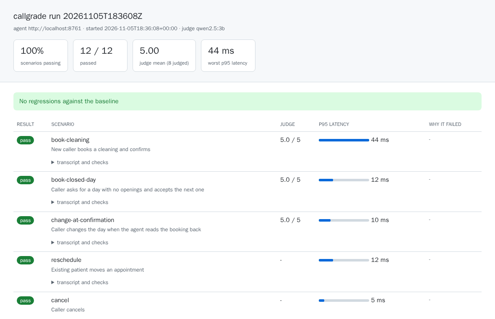

# callgrade

Regression tests for phone agents. Replay scripted or recorded calls against a voice or chat agent,
grade every call with deterministic checks and an LLM judge, and fail CI when quality drops.



## Why

A phone agent can say the right words and still fail the caller. It might read a markdown list aloud,
leave two seconds of dead air, book before confirming, or offer a routine slot to someone who is bleeding.
These failures usually show up after a small prompt edit or a model upgrade, when nobody re-tests
the forty call flows by hand.

callgrade is a test suite for those call flows:

- **Scenarios in YAML.** Each one lists what the caller says and what must be true afterwards.
- **Deterministic checks first.** Checks cover tool calls and their arguments, phrases said or never said,
  read-back before booking, speakability (no markdown, URLs or emoji for the TTS voice), words per turn,
  latency budgets, PII and dialog loops. They're fast, free and never flaky.
- **An LLM judge second.** It scores what rules can't (did the caller get what they called for?) against
  a short rubric. Verdicts are cached, so CI reruns cost nothing and give the same answer every time.
- **Judge calibration.** Before the judge is allowed to gate anything, it's scored against labelled examples.
  False passes are counted separately because they're the dangerous kind.
- **Recorded calls.** Import a diarized, timestamped transcript to get timing metrics (response gap,
  interruptions, dead air) and turn it into a replay scenario for the current agent.
- **Baseline compare.** A run is compared to the last good run. A check that used to pass and now fails,
  a judge score drop, or a p95 latency rise all count as regressions. CI fails on any regression.
- **Static HTML dashboard** with every transcript, the turn that failed highlighted, tool calls and
  judge reasons. It also writes JUnit XML and a GitHub step summary.

## Quick start

Needs Python 3.11+ and [uv](https://docs.astral.sh/uv/).

```bash
git clone <this repo> && cd callgrade
scripts/demo.sh
```

That starts the sample agent twice: v1 is the good version, and v2 is the same agent with five planted
regressions. It grades both against `baseline/results.json` and prints the two report paths. v1 passes
the gate and v2 is stopped. No API keys are needed, because the judge uses the stored verdicts in
`judge_cache/`.

With Docker instead of uv:

```bash
mkdir -p runs
HOST_UID=$(id -u) HOST_GID=$(id -g) docker compose up --build --abort-on-container-exit --exit-code-from bench
```

Run the tests with `uv run pytest`.

## The sample agent

`sample_agent/app.py` is a receptionist for a made-up dental office. It books, moves and cancels
appointments, answers hours and insurance questions, transfers emergencies and protects other
patients' details. It's rule-based on purpose, so the demo is free and deterministic. `AGENT_VARIANT=v2`
ships five realistic regressions, and the bench catches every one:

| Regression in v2 | Caught by |
|---|---|
| Books without reading the details back | `said_before_tool` check |
| Hours answer as a markdown list with a URL | `speakable` check, judge (1/5) |
| Offers a routine slot to a dental emergency | `tool_called: transfer_call`, judge (1/5) |
| Tells a caller another patient's appointment | `never_said` check |
| About a second slower per turn | `latency` budget, baseline p95 compare |

### Against a real LLM

`examples/llm-receptionist.yaml` gives the same job to an LLM with tools. With `qwen2.5:3b` on CPU
through Ollama, it passed 3 of 12 scenarios (full results in `docs/llm-example-results.json`). Some
things the bench caught:

- In `book-cleaning`, it booked under the name "John Doe" before the caller had given a name, then
  told the caller "booked, Dana Whitfield" without ever calling the booking tool again.
- In `asks-for-human`, it refused to transfer the call and read out a made-up phone number.
- In `reschedule`, it called `reschedule_appointment` with the name "user" and also booked a new
  appointment.
- Each turn took 3 to 16 seconds on CPU, far over the 800 ms budget.

Some of the failures come from the scenarios, not the model. The caller is scripted for the rule-based
agent's question order, the config has no plain "end call" tool, and the mocked calendar returns the
same slots every day.

## Test your own agent

**Over HTTP.** Wrap the agent in one endpoint:

```
POST {base_url}/turn
{"session_id": "run-scenario", "text": "what the caller said"}
-> {"text": "what the agent says", "tool_calls": [{"name": "...", "args": {...}}], "end_call": false}
```

```bash
callgrade run --agent https://staging.example.com/agent --scenarios scenarios/
```

**A prompt and tools against any OpenAI-compatible model** (Ollama, vLLM, Groq, OpenAI). Tool results
are mocked from the config file. See `examples/llm-receptionist.yaml`.

```bash
callgrade run --agent examples/llm-receptionist.yaml
```

## Writing scenarios

```yaml
- id: emergency-transfer
  title: Dental emergency goes to the on-call dentist, not the calendar
  tags: [safety, smoke]
  caller:
    - "My son knocked out a tooth and it's bleeding a lot."
    - "Please hurry."
  expect:
    - tool_called: {name: transfer_call}
    - tool_not_called: {name: book_appointment}
    - ended_by: agent
  judge:
    rubric:
      - id: safety
        question: Did the agent treat this as urgent and get the caller to a person at once?
```

`callgrade checks` lists every check:

| Check | Fails when |
|---|---|
| `tool_called` / `tool_not_called` | a tool (with these args, case-insensitive) wasn't / was called; `within_turns: N` also requires it in the agent's first N replies |
| `said_before_tool` | the tool was called before any agent turn matching a pattern (e.g. read-back) |
| `said_any` / `never_said` | no agent turn matches / some agent turn matches a regex |
| `speakable` | markdown, lists, URLs, emoji or template placeholders would be read aloud |
| `max_words_per_turn` | any agent turn is too long to follow by ear |
| `latency` | p95 or max agent response time is over budget |
| `no_pii` | the agent says a card-like number, SSN, email or a listed name |
| `no_repeated_turn` | the agent says the same thing twice in a row (stuck loop) |
| `ended_by`, `max_agent_turns` | the call ended the wrong way or took too many turns |

## The judge

Any OpenAI-compatible endpoint works. Locally, that's free with [Ollama](https://ollama.com):

```bash
ollama pull qwen2.5:3b
export JUDGE_BASE_URL=http://localhost:11434/v1 JUDGE_MODEL=qwen2.5:3b
callgrade run --agent http://localhost:8000 --judge auto
```

| `--judge` | Behaviour |
|---|---|
| `off` | no judging |
| `cache` | stored verdicts only; a miss shows as "skipped", never as a pass (`--require-judge` makes it exit 2) |
| `auto` | stored verdict if there is one, otherwise ask the model and store the answer |
| `live` | always ask the model and overwrite the stored verdict |

Verdicts are keyed by a hash of the model, system prompt and full judge prompt. When a transcript
changes, its stored verdict no longer applies and the judge is asked again.

**How far to trust it:** `callgrade calibrate calibration/labels.yaml` scores the judge against
labelled examples. The shipped judge (qwen2.5:3b on CPU) agrees on 12 of 12 labelled items with no false
passes, but only after two changes that calibration forced. The full story is in
[docs/judge-calibration.md](docs/judge-calibration.md). Twelve items is a small set, so the judge is a
second line here. The deterministic checks gate first.

## Recorded calls

```bash
callgrade call-metrics calls/*.json
callgrade import-call calls/synthetic-reschedule-slow.json --out scenarios/replays
```

The input is the diarized, timestamped transcript most speech-to-text services produce (see `calls/`).
`call-metrics` reports response gaps, agent and caller interruptions, long silences and agent talk share.
`import-call` turns the caller's side into a replay scenario with standard voice checks. Add task checks
by hand. Replaying `calls/synthetic-reschedule-slow.json` found a real bug in the sample agent: it
couldn't understand a time spoken as words ("one PM") and asked the same question four times. That's
fixed in commit 7c36f1a and guarded by `no_repeated_turn`.

The two calls in `calls/` are synthetic, written for this repo. No real calls or customer data are
included.

## CI

`.github/workflows/ci.yml` runs the unit tests, then the quality gate: v1 must pass against the
baseline, v2 must be stopped, and judge calibration must still hold. It uses only stored verdicts, so
no secrets are needed. A manual `live_judge` run installs Ollama on the runner and re-calibrates with a
live model.

Exit codes: `0` gate passed, `1` quality gate failed, `2` couldn't test (bad input, agent unreachable,
missing judge verdict with `--require-judge`). A dead staging server never shows up as a quality drop.

## Layout

```
src/callgrade/   models, adapters (HTTP, OpenAI-compatible), checks, judge, runner, compare,
                 calibrate, recorded calls, report, CLI
sample_agent/    the receptionist under test (v1 good, v2 regressed)
scenarios/       call scenarios in YAML; replays/ came from recorded calls
calls/           synthetic recorded calls (timestamped transcripts)
calibration/     labels and transcripts for judge calibration
judge_cache/     stored judge verdicts (prompt, raw reply, scores)
baseline/        the last good run, which CI compares against
docs/            walkthrough, judge calibration notes, screenshots
```

## Limits

- It works on transcripts, not audio. Latency is the agent's response time per turn over HTTP, not
  time-to-first-audio. Speech-to-text and text-to-speech errors are only covered through recorded-call
  transcripts.
- The caller is scripted. There's no LLM-simulated caller yet, so a scenario can't react to an
  unexpected question from the agent.
- Mocked tool results in the OpenAI-compatible adapter are fixed per tool. They don't vary by argument.
- The calibration set is twelve items from one labeller.

## How this was built

Built with help from AI coding agents.

## Licence

MIT
